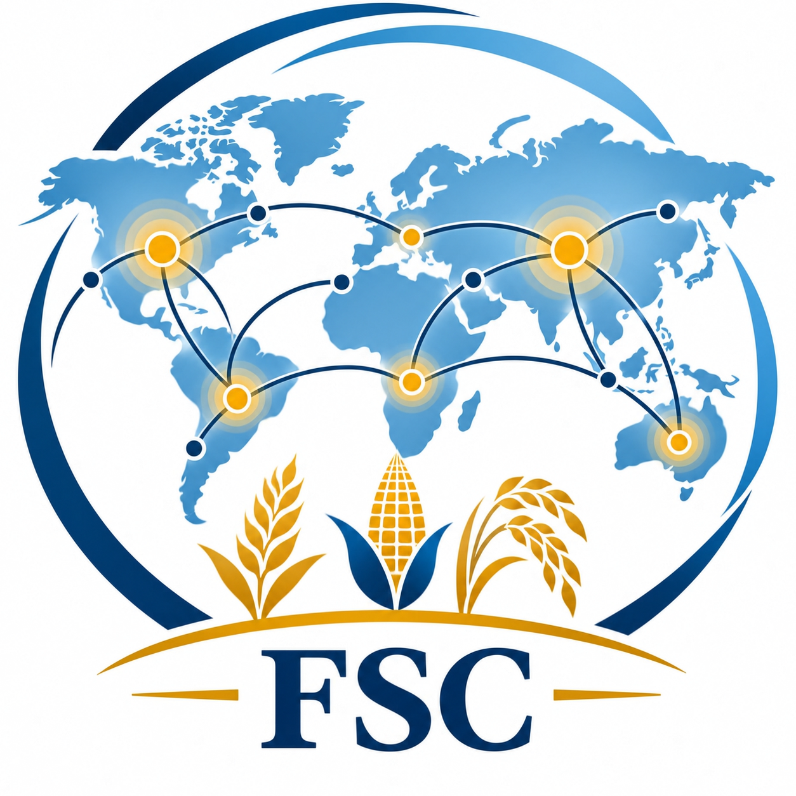

<p align="center">
  
</p>

# Food Shock Cascade

The Food Shock Cascade (FSC) is a country-level model of one crop at a time. A production loss or an export ban changes supply. Countries then draw stocks, cut domestic use, and adjust trade along links that already exist. The result is a new pattern of consumption and trade. There are no households, no prices in the cascade, and no substitution between crops.

The published model is Heslin, Puma, Marchand, and coauthors, 2020, *Simulating the cascading effects of an extreme agricultural production shock*, Frontiers in Sustainable Food Systems, doi:10.3389/fsufs.2020.00026. That paper is the proportional-trade and reserves-trade pair, run in kilocalories. The earlier statement of the rules is Marchand and coauthors, 2016, *Reserves and trade jointly determine exposure to food supply shocks*, Environmental Research Letters, doi:10.1088/1748-9326/11/9/095009, with code at https://github.com/pmarchand1/cereals-network-shocks.

This repository also holds a metric-ton build for 2002 to 2024, used for a flood comparison with Junshi Xia (RIKEN). That build is described under [Flood scenarios](#flood-scenarios). It does not replace the published kilocalorie scenarios.

Run every command from the repository root.

## What a run is

Each country is one node. The time step is one year, long enough for a shock to move through trade. A run starts from a baseline network:

- `P`: production
- `R`: beginning stocks that the scenario is allowed to use
- `E`: bilateral exports. `E_ij` is the flow from country `i` to country `j`. The diagonal is zero.
- `C`: domestic use

Baseline use, before any stock change, is

```
C_i = P_i + imports_i - exports_i
```

Imports are the column sum of `E`. Exports are the row sum.

Supply during the cascade is

```
S_i = P_i + imports_i - exports_i - dR_i
```

`dR_i` is the stock change. A positive `dR` is grain held back, so it reduces supply. A reserve draw makes `dR` smaller and raises supply. Shortage is booked use minus supply:

```
shortage_i = C_i - S_i
```

The code stops if shortage is materially negative. That check is there so the books cannot create grain. The tolerance is `1e-8` times the local scale of use or production, which keeps the same test valid in kilocalories and in tonnes.

## Shocks and parameters

A production shock is a loss. In the scenario files a positive fraction means a decline. Inside the simulator the applied change `dP` is zero or negative, and it cannot exceed baseline production:

```
P_i <- max(P_i + dP_i, 0)
dP_i <= 0
dP_i >= -P_i
```

Alpha is the share of beginning stocks that may be drawn. It is applied once, before the loop, and it is clamped to the interval from 0 to 1:

```
R_i <- alpha * max(R_i, 0)
```

An export ban removes a fraction `f_i` of country `i`'s export row. The withdrawn grain is added to stocks and recorded as a stock build, so the exporter's own supply does not jump when exports fall. Partners lose the imports.

```
q_i = f_i * (sum of row i)
E_ij <- (1 - f_i) * E_ij
R_i <- R_i + q_i
dR_i <- dR_i + q_i
```

The banned country is then frozen, so a later iteration cannot put that grain back on the market.

Each iteration does three things.

1. Draw reserves, up to the shortage and up to usable stocks.

```
draw_i = min(max(shortage_i, 0), R_i)
dR_i <- dR_i - draw_i
R_i <- R_i - draw_i
```

2. Cut domestic use by a small share of the remaining shortage. The share is `gamma = 0.01`. The cut cannot drive use below zero.

```
cut_i = min(gamma * max(shortage_i, 0), max(C_i, 0))
```

3. Reallocate trade. The rule depends on the mode below.

The loop stops when the trade matrix stops changing, or after 50 iterations. At the end, use is set to supply, and exports are cut if supply would otherwise be negative:

```
C_i = max(S_i, 0)
```

World trade cancels. The change in world use equals the production change minus the net stock build, aside from any country whose supply was clipped at zero.

Because `gamma` is 0.01, a production loss is mostly pushed into trade. The shocked country keeps most of its own use and cuts exports. That is the published FSC behavior. It is a different question from "what share of a harvest loss stays in the country that lost the crop?"

## Two modes

`main/main.R` selects the mode with its first argument.

| Argument | Mode | What trade does |
|---|---|---|
| 0 | Proportional trade allocation (PTA) | A country with unmet need cuts its own exports and raises imports along links that already exist. No new link is opened. |
| 1 | Reserves-based trade allocation (RTA) | Exports are cut in proportion to need. Exporters may then offer 20 percent of remaining usable reserves along existing links. |

PTA. Let `F` be the set of frozen exporters. Country `j` can cover its need from its own exports plus imports from exporters that are not frozen:

```
T_j = exports_j + imports_j from countries not in F
pi_j = min(1, need_j / T_j)
E_ij <- max(0, (1 + 1_{i not in F} * pi_j - pi_i) * E_ij)
```

In the published code, a country is frozen when its usable reserves are zero, and also when a ban has been applied to it. At `alpha = 0` every country has zero usable reserves, so PTA freezes the whole network. Partners of a banned exporter cannot be resupplied by anyone else.

`sim_cascade_PTA` has an extra argument, `freeze_empty_reserves`, default `TRUE`. Set it to `FALSE` to leave stocks unused and still let other exporters shift volume along existing links. Only an explicit ban stays frozen. The flood figures use both settings. The published `main.R` path does not. It always freezes empty reserves.

RTA. After the export cut, an exporter offers

```
offer_i = 0.20 * R_i
```

A banned exporter's offer is set to zero. With `alpha = 0` there is nothing to offer, so RTA leaves the loss on the importers. That is why an RTA run with no stocks looks like PTA with the network frozen.

There is a third rule, used by Junshi Xia for the flood note of 12 November 2026, that is not in this code. After stocks, his cascade splits the remaining deficit in proportion to exports and domestic use, then passes the export cut to current partners and repeats until less than 1 tonne is left. FSC does not run that split. The flood section below says which rules were actually run.

## How to run a published scenario

Install the R packages once:

```
Rscript main/Requirements.R
```

The dynamic model takes three arguments: mode, scenario number, alpha.

```
Rscript main/main.R 0 1 0.5
```

That line is PTA, scenario 1 (the one-year wheat shock), and half of beginning stocks available.

```
Rscript main/main.R 1 4 1
```

That line is RTA, scenario 4 (four-year US wheat shock), and all beginning stocks available.

The static model only applies the production decline to supply. It does not reallocate trade. It takes the scenario number:

```
Rscript main/main_static.R 1
```

`main.R` and `main_static.R` write fixed file names under `outputs/`. Running them replaces the saved scenario outputs. Use the flood scripts in the next section when the goal is the metric-ton comparison. Those scripts write under `outputs/yawei_benchmarks/` and `outputs/export_for_RIKEN/`.

Processed kilocalorie networks for the scenario library already live in `inputs_processed/`. You can skip input preparation for scenarios 1 to 4 and the static scenarios listed below.

To rebuild a processed network, edit the years and the crop lists in `main/ProcessInputs.R`, then:

```
Rscript main/ProcessInputs.R --crop wheat --years 2015:2017 --unit kcal
```

`unit` is `kcal` or `tonnes`. The scenario library was built in kilocalories. Soybean has no kilocalorie factor in the ancillary tables, so a soybean kilocalorie build stops on purpose.

## Input files

### Ancillary lists

| File | Contents |
|---|---|
| `ancillary/country_list195_2012to2016.csv` | The 195 countries: FAO code, ISO3, name |
| `ancillary/cropcommodity_tradelist.csv` | Trade commodities and conversion factors |
| `ancillary/cropcommodity_prodlist.csv` | Production commodities and conversion factors |
| `ancillary/cropcommodity_reserveslist.csv` | Reserve commodities and conversion factors |
| `ancillary/mass_equivalent_factors.csv` | Tonne factors for wheat, maize, and soybean products |

China mainland is FAO 41, ISO3 CHN. Taiwan is FAO 214, ISO3 TWN. They are not combined. Angola is not on the 195-country list.

### Raw data for a new build

Production and trade are FAOSTAT bulk files. Stocks are USDA PSD. Current bulk addresses:

```
https://bulks-faostat.fao.org/production/Production_Crops_Livestock_E_All_Data_(Normalized).zip
https://bulks-faostat.fao.org/production/Trade_DetailedTradeMatrix_E_All_Data_(Normalized).zip
https://apps.fas.usda.gov/psdonline/downloads/psd_alldata_csv.zip
```

The trade zip is served from the production folder on that host. The older `fenixservices.fao.org` links in earlier notes no longer answer.

```
python3 main/fetch_faostat_bulk.py --min-year 2024
```

That script streams the zip to disk, checks that the newest year is at least 2024, and replaces the local production CSV. The trade CSV is large (several gigabytes). The script writes it to the FoodTradeNetwork path used by the exporter. It does not modify any other repository.

### Shock files

A shock file is a table of fractional production declines by country and year. Positive means a decline. Examples:

- `inputs/Scenario1_COVID_WheatDeclineFraction_1Year_195countries.csv`
- `inputs/Scenario4_USDustBowl_WheatDeclineFraction_4Years_195countries.csv`
- `inputs/yawei_placeholder_flood_shocks.csv` for the flood comparison

### Processed files

`ProcessInputs.R` writes `inputs_processed/`: an export matrix `E0`, production `P0`, and reserves `R0`, plus the shock file copied forward. The published scenarios are in kilocalories on a 2015 to 2017 mean network.

## Flood scenarios

This section is the metric-ton work for the RIKEN flood comparison. Junshi Xia's note of 12 November 2026 estimates flood losses of rice, wheat, and maize for 2002 to 2024 and runs a simple stock-then-split cascade on each year's trade network. He asked whether those shocks can be run on this network. The shock table itself (his 422 country-years) is not in the repository. Until it arrives, the flood runs use placeholder fractions.

### What was run, and what was not

The flood figures ran FSC, not Junshi's split.

| Run | Rule in the code | Stocks | Trade |
|---|---|---|---|
| PTA, frozen | `freeze_empty_reserves = TRUE` | Unused when alpha is 0 | Every exporter with zero usable reserves is frozen. At alpha 0 that is everyone. |
| PTA, reroute | `freeze_empty_reserves = FALSE` | Unused when alpha is 0 | Other exporters can still move grain on existing links. A ban stays closed. |
| RTA | `sim_cascade_RTA` | Same alpha | Extra trade is offered only out of remaining reserves. At alpha 0 there is no offer. |

Alpha 1 in those runs means all USDA beginning stocks may be drawn. The published default remains PTA with the freeze on. Turning the freeze off is a comparison switch for the flood figures. It is not a new default.

The placeholder floods are not Junshi's losses. Each row is marked `placeholder_pending_junshi`. A US shock hits the whole United States node, not a Midwest subset.

| Event | Crop | Node | Production loss | Reactive ban |
|---|---|---|---|---|
| Thailand 2011 | Milled rice | THA | 15% | 95% |
| Pakistan 2022 | Wheat | PAK | 10% | 95% |
| Pakistan 2022 | Milled rice | PAK | 10% | 95% |
| Myanmar 2008 | Milled rice | MMR | 15% | 95% |
| US Midwest 2011 | Maize | USA | 10% | 95% |
| US Midwest 2011 | Wheat | USA | 5% | 95% |

Replace `inputs/yawei_placeholder_flood_shocks.csv` with his fractions and rerun the two R scripts below. Do not treat the current flood maps as history.

### Network package

`main/export_riken_inputs.py` writes `outputs/export_for_RIKEN/` and `outputs/export_for_RIKEN.zip`. Units are metric tons. Years are 2002 to 2024. Crops are milled rice, wheat, maize, and soybean. `README_FSC_Inputs.md` in that folder is the column-by-column note.

Rice production is FAO item 27 (paddy) times 0.67. Rice trade uses 0.67 for paddy, 0.8375 for husked rice, and 1 for milled rice, broken rice, and rice flour. PSD `Rice, Milled` is already milled and is not scaled again. PSD values are published in thousand metric tons and stored here in metric tons. The PSD market year is joined to the FAO calendar year on the year number. There is no marketing-year shift.

Trade is FAOSTAT export quantity. Self-trade is dropped. Flows outside the 195-country list are dropped. Re-exports are netted for Hong Kong, the United Arab Emirates, Singapore, the Netherlands, and Italy. For each hub, re-exports are `min(exports, imports)`, and the export row is scaled down by that amount. The removed flow is not assigned to an upstream seller. `trade_mt_net` is the column to use. Its world sum is a sum of bilateral flows, so it can sit above a published "world trade" total.

`beginning_stocks_mt` is blank when USDA has no row. `PSD_Missing_Flag` is 1 only then. `reserves_imputed_mt` is optional: the same-year median stock-to-use of countries with a reported stock, times domestic use. Junshi's note treats a missing stock as zero. The flood benchmark instead fills blanks with the imputation, then with zero. Both columns are in the file.

EU stocks are one USDA row and are shared across the EU-28 member list in `ProcessInputs_funcs.R`, including the United Kingdom. Malta is in the 195 and is not in that member list.

Rebuild:

```
python3 main/export_riken_inputs.py
```

Or pass new FAOSTAT paths after a bulk refresh:

```
python3 main/export_riken_inputs.py \
  --production /path/to/Production_Crops_Livestock_E_All_Data_(Normalized).csv \
  --trade /path/to/Trade_DetailedTradeMatrix_E_All_Data_(Normalized).csv \
  --psd /path/to/psd_alldata.csv
```

`main/export_riken_inputs.R` is a thin wrapper around the same Python script. Run it from the repository root.

### Benchmark and figures

The benchmark builds 2018 to 2021 mean networks from the RIKEN package and runs export bans plus the placeholder floods.

```
Rscript main/run_yawei_benchmarks.R
```

Bans cover wheat exporters (Russia, Canada, EU-28, the United States, Ukraine, Australia, Argentina, Kazakhstan, Pakistan) and rice exporters (India, Thailand, Vietnam, Pakistan, the United States, Myanmar). Restrictions are 50% and 95%. Durations are a full year and six months, with the six-month case counted as half of the annual fraction. Alpha is 0, 0.25, 0.5, and 1. Results go to `outputs/yawei_benchmarks/benchmark_results.csv`. The rice price column in that file uses an uncalibrated index (`beta_surplus = -1`, `beta_stu = -0.5`). It is not a world-price forecast and it is not plotted.

Country and edge detail for the figures:

```
Rscript main/export_figure_cases.R
python3 main/plot_report_figures.py
```

Figures and `REPORT.md` land in `outputs/yawei_benchmarks/`. The figure cases are full-year 95% bans at alpha 0 and alpha 1, for the frozen PTA rule, the reroute PTA rule, and RTA on the headline shocks. The longer model note, with the food-security framing, is `outputs/yawei_benchmarks/FSC_model_food_security.docx`. A draft letter describing the network package is `outputs/export_for_RIKEN/Note_for_Junshi_Xia.docx`.

Headline availability results on the 2018 to 2021 mean, 95% bans:

| Shock | Stocks unused, trade frozen | Stocks unused, trade can reroute | Beginning stocks usable |
|---|---|---|---|
| Russia wheat | 33.85 Mt (4.44% of world use) | 33.85 Mt (4.44%) | 0.18 Mt (0.02%) |
| India rice | 13.41 Mt (2.60%) | 13.41 Mt (2.60%) | 0.22 Mt (0.04%) |
| US maize | 55.86 Mt (4.86%) | 55.86 Mt (4.86%) | 4.02 Mt (0.35%) |

The world total does not change when trade is allowed to reroute. The world total is the grain held back as stocks. Rerouting changes which countries eat less. With trade frozen, an Indian rice ban cuts Gulf use by about 70%. With rerouting, that Gulf loss is about 15%, and the tonnes show up as lower use in other rice exporters.

These percentages are shares of that commodity's use. They are not shares of calories or of a household diet.

### Checks on the flood package

On the files as built: production has 195 countries in every year from 2002 to 2024, no duplicate country-years, and no negative tonnes. Rice production uses the single factor 0.67. Trade files have no self-trade and no negative flows. 2024 production in the package is 798 Mt of wheat, 1,215 Mt of maize, 398 Mt of soybean, and 549 Mt of milled rice. About a quarter of wheat stock rows have no USDA beginning stock. They are flagged, not filled with a silent zero.

Wheat and rice ban runs close the world balance within 1 kt: the fall in use equals the stock build. Every maize run carries the same gap of about 0.12 Mt, including a production shock that stocks cover completely, so that residual is in the baseline maize balance. The largest other gap is 0.37 Mt, on the EU-28 wheat ban with trade frozen.

```
Rscript tests/test_fsc_safety.R
Rscript tests/test_rice_price_step.R
Rscript tests/test_process_inputs.R
```

The safety test checks non-negative production, use, and exports, a zero diagonal, the alpha clamp, and the export-ban accounting. It does not reproduce a published table from the 2020 paper.

## Outputs of a published run

`main.R` writes three groups of CSV files under `outputs/`. Units follow `ProcessInputs.R`, usually kilocalories.

Bilateral exports, origin by destination, with one block of columns per year:

- `BilateralExportMatrix_TimeSeries.csv`

Country time series (`iso3`, country name, year, value):

- `Production_TimeSeries.csv`
- `Reserve_TimeSeries.csv`
- `Shortage_TimeSeries.csv`
- `ConsumptiontoC0_TimeSeries.csv` (use divided by initial use)
- `ReserveChangetoC0_TimeSeries.csv` (stock change divided by initial use)

Network summaries at the start and the end of the run:

- `Export_InitialTotalByCountry.csv`, `Export_FinalTotalByCountry.csv`
- `Import_InitialTotalByCountry.csv`, `Import_FinalTotalByCountry.csv`
- `NumberExportTradePartners_InitialTotalByCountry.csv`, `NumberExportTradePartners_FinalTotalByCountry.csv`
- `NumberImportTradePartners_InitialTotalByCountry.csv`, `NumberImportTradePartners_FinalTotalByCountry.csv`

## Scripts

| Script | Role |
|---|---|
| `main/main.R` | Dynamic FSC. Argument 1 is PTA (0) or RTA (1). Argument 2 is the scenario. Argument 3 is alpha. Writes `outputs/`. |
| `main/main_static.R` | Production shock only. One argument, the scenario number. Writes `outputs/`. |
| `main/ProcessInputs.R` | Builds `E0`, `P0`, `R0` from FAOSTAT and PSD. |
| `main/FSC_sim_funcs.R` | `sim_cascade_PTA` and `sim_cascade_RTA`. |
| `main/FSC_component_funcs.R` | Supply, shortage, reserve draw, trade update, export bans. |
| `main/fetch_faostat_bulk.py` | Downloads FAOSTAT production and trade through at least 2024. |
| `main/export_riken_inputs.py` | Writes the metric-ton package for 2002 to 2024. |
| `main/run_yawei_benchmarks.R` | Export-ban and placeholder-flood grid. Writes `outputs/yawei_benchmarks/`. |
| `main/export_figure_cases.R` | Country and edge results for the figures. |
| `main/plot_report_figures.py` | Maps and charts, and `outputs/yawei_benchmarks/REPORT.md`. |
| `R/rice_price_step.R` | Uncalibrated rice price index. Not used in the figures. |

## Scenario library

Scenarios 1 to 4 are the dynamic runs in `main.R`. The static script uses the same shock files for scenarios 1 to 3, and a separate block of wheat, maize, and rice cases from 11 upward. Baselines for this library are 2015 to 2017 means, in kilocalories. Production fractions below are declines.

### Dynamic scenarios

**1. Wheat, one year.** COVID-19 and locust disruption, 2020. Kenya 0.4916, Saudi Arabia 0.4483, Yemen 0.2335, Ukraine 0.205, Kazakhstan 0.1818, Iran 0.1024, Pakistan 0.0976, Ethiopia 0.0874, Russia 0.0768.

**2. Maize, one year.** Same class of shock. Saudi Arabia 0.5281, Somalia 0.4844, Iran 0.2975, Yemen 0.2518, Kenya 0.1521, Brazil 0.1328, Ethiopia 0.1301, Argentina 0.119, Ukraine 0.0878, Pakistan 0.0717.

**3. Rice, one year.** Kenya 0.3425, Pakistan 0.197, Iran 0.1883, Thailand 0.021, India 0.0192, Viet Nam 0.0012.

**4. US wheat, four years.** Dust Bowl analogue. US decline fractions 0.33, 0.36, 0.24, 0.24.

### Static scenarios

Scenarios 1 to 3 repeat the shocks above without trade reallocation.

Scenarios 11 to 16 are wheat on the 2015 to 2017 network. Scenarios 21 to 26 are maize. Scenarios 31 to 34 are rice. Input names:

| Number | Run name | Shock or restriction file |
|---|---|---|
| 11 | Wheat_breadbasket_Year2008 | `Scenario_Wheat_DeclineFraction_breadbasket_Year2008_195countries.csv` |
| 12 | Wheat_locust_Year2020 | `Scenario_Wheat_DeclineFraction_locust_Year2020_195countries.csv` |
| 13 | Wheat_locust_Year2020_breadbasket_Year2008 | `Scenario_Wheat_DeclineFraction_locust_Year2020_breadbasket_year2008_195countries.csv` |
| 14 | Wheat_ExportRestrictionFraction_Year2008 | `Scenario_Wheat_ExportRestrictionFraction_Year2008_195countries.csv` |
| 15 | Wheat_ExportRestrictionFraction_Year2008with_RUS_25 | `Scenario_Wheat_ExportRestrictionFraction_Year2008_with_RUS_25%_195countries.csv` |
| 16 | Wheat_ExportRestrictionFraction_Year2008with_RUS_50 | `Scenario_Wheat_ExportRestrictionFraction_Year2008_with_RUS_50%_195countries.csv` |
| 21 | Maize_breadbasket_Year2008 | `Scenario_Maize_DeclineFraction_breadbasket_Year2008_195countries.csv` |
| 22 | Maize_locust_Year2020 | `Scenario_Maize_DeclineFraction_locust_Year2020_195countries.csv` |
| 23 | Maize_locust_Year2020_breadbasket_Year2008 | `Scenario_Maize_DeclineFraction_locust_Year2020_breadbasket_year2008_195countries.csv` |
| 24 | Maize_ExportRestrictionFraction_Year2008 | `Scenario_Maize_ExportRestrictionFraction_Year2008_195countries.csv` |
| 25 | Maize_ExportRestrictionFraction_Year2008with_ARG_25 | `Scenario_Maize_ExportRestrictionFraction_Year2008_with_ARG_25%_195countries.csv` |
| 26 | Maize_ExportRestrictionFraction_Year2008with_ARG_50 | `Scenario_Maize_ExportRestrictionFraction_Year2008_with_ARG_50%_195countries.csv` |
| 31 | Rice_breadbasket_Year2008 | `Scenario_Rice_DeclineFraction_breadbasket_Year2008_195countries.csv` |
| 32 | Rice_locust_Year2020 | `Scenario_Rice_DeclineFraction_locust_Year2020_195countries.csv` |
| 33 | Rice_locust_Year2020_breadbasket_Year2008 | `Scenario_Rice_DeclineFraction_locust_Year2020_breadbasket_year2008_195countries.csv` |
| 34 | Rice_ExportRestrictionFraction_Year2008 | `Scenario_Rice_ExportRestrictionFraction_Year2008_195countries.csv` |

Those CSV paths sit under `inputs/2021_C2P2_scenarios/`. Scenarios 14 to 16, 24 to 26, and 34 are export restrictions with no production decline. The others are production declines with no export restriction.

## Runtime

Building inputs from the raw FAOSTAT files takes longer than a cascade. A cascade on the 195-country network is a few minutes on a desktop. The metric-ton benchmark grid is shorter than that once the RIKEN CSVs exist.
