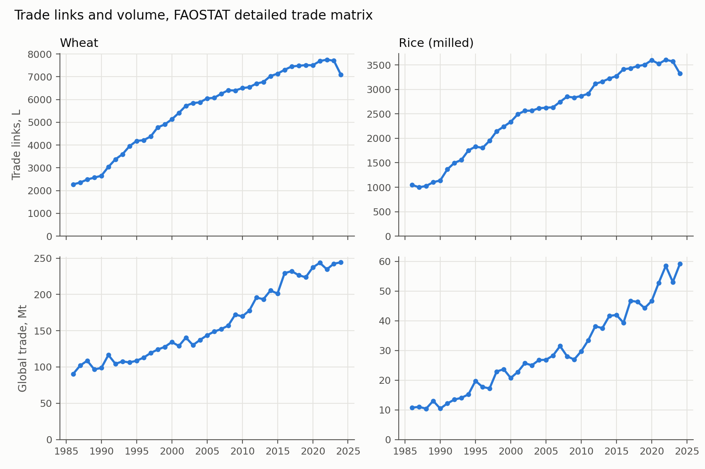
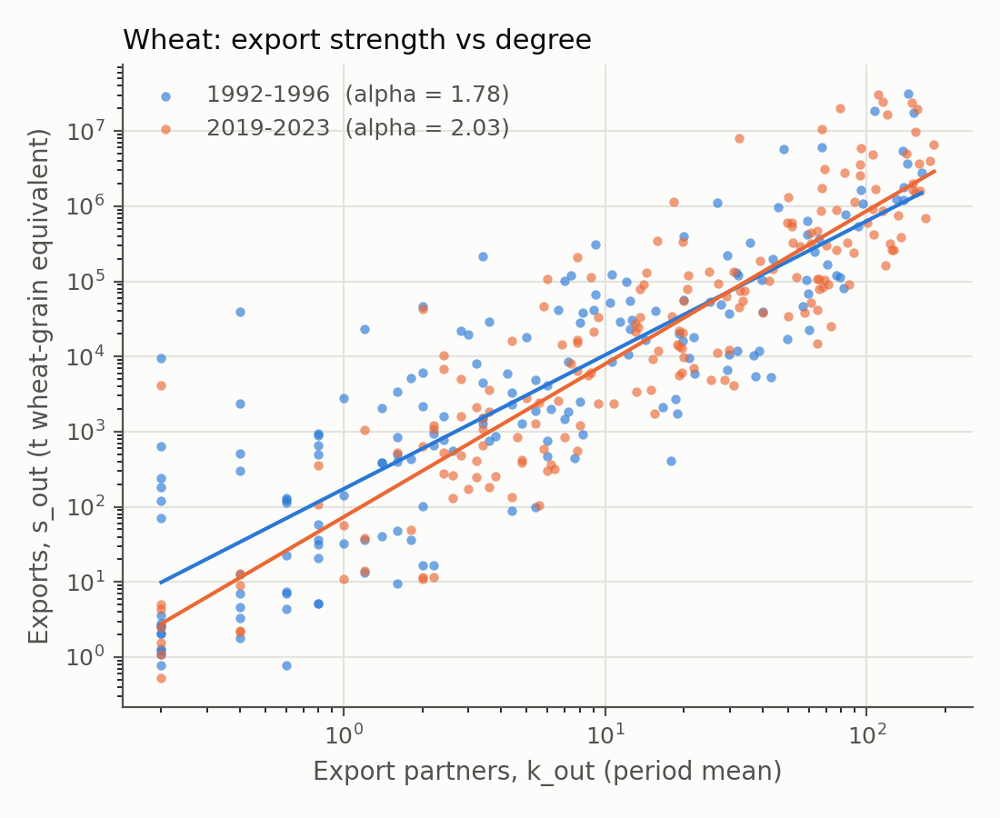
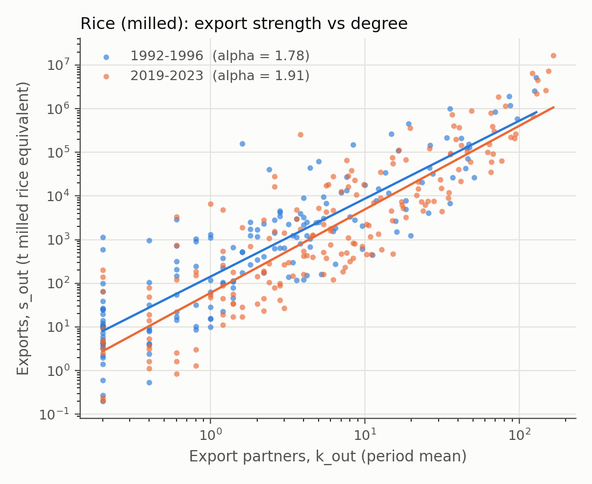
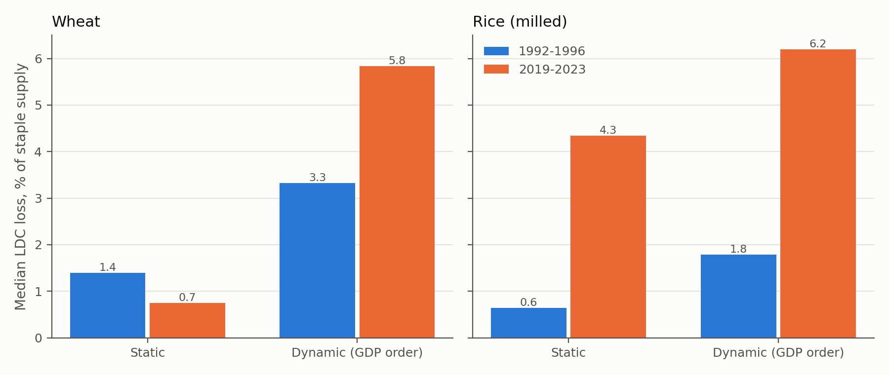

# Python implementation of Puma et al. (2015), updated for recent data

Puma, M.J., Bose, S., Chon, S.Y., Cook, B.I. (2015). Assessing the evolving fragility of the
global food system. *Environmental Research Letters* 10, 024007. doi:10.1088/1748-9326/10/2/024007

Generated by `python -m fsc2015 run`. Wheat is in wheat-grain equivalent tonnes and rice in
milled-rice tonnes. Staple supply is FAOSTAT cereals (excluding beer) plus 0.26 times starchy
roots. Periods: 1992-1996, 2019-2023. Values are means
of the yearly values in each period.

## Wheat: export ban `europe_wheat_1816`

Banned exporters with nonzero exports: 17 to 17 per year. LDCs whose imports of this crop exceed their whole staple supply, and those in `ancillary/ldc_summary_exclusions.csv` (Djibouti, a transit port), are left out of the LDC rows.

### Undisturbed network (table 1 analogue)

| metric | 1992-1996 | 2019-2023 |
| --- | --- | --- |
| Global trade, Mt/yr | 107.98 | 236.34 |
| Links | 3,864.40 | 7,631.80 |
| Active exporters | 146.00 | 179.20 |
| Active importers | 197.40 | 197.80 |
| Mean export degree | 26.43 | 42.60 |
| Mean import degree | 19.57 | 38.58 |
| Mean export strength, Mt/yr | 0.74 | 1.32 |
| Mean import strength, Mt/yr | 0.55 | 1.19 |
| Max export degree | 162.00 | 181.20 |
| Max import degree | 72.40 | 121.40 |
| Max export strength, Mt/yr | 31.59 | 31.99 |
| Max import strength, Mt/yr | 8.87 | 11.47 |

### Losses from the ban, static accounting (table 2 analogue)

| metric | 1992-1996 loss | 1992-1996 loss % | 2019-2023 loss | 2019-2023 loss % |
| --- | --- | --- | --- | --- |
| Global trade, Mt/yr | 35.79 | 33.15 | 55.22 | 23.37 |
| Links | 1,360.80 | 35.21 | 1,939.60 | 25.41 |
| Active exporters | 17.00 | 11.64 | 17.00 | 9.49 |
| Active importers | 1.40 | 0.71 | 0.00 | 0.00 |
| Mean export degree | 7.06 | 26.71 | 7.50 | 17.59 |
| Mean import degree | 6.80 | 34.76 | 9.81 | 25.42 |
| Mean export strength, Mt/yr | 0.18 | 24.33 | 0.20 | 15.31 |
| Mean import strength, Mt/yr | 0.18 | 32.68 | 0.28 | 23.37 |
| Max export degree | 17.80 | 10.99 | 0.00 | 0.00 |
| Max import degree | 14.80 | 20.44 | 17.00 | 14.00 |
| Max export strength, Mt/yr | 0.00 | 0.00 | 0.00 | 0.00 |
| Max import strength, Mt/yr | 0.95 | 10.69 | 0.57 | 4.98 |

### Least developed countries, loss as % of staple supply

| period | n_ldc | excluded_transit | static_median_pct | static_mean_pct | dynamic_median_pct | dynamic_mean_pct |
| --- | --- | --- | --- | --- | --- | --- |
| 1992-1996 | 37 | Djibouti | 1.39 | 4.20 | 3.33 | 8.15 |
| 2019-2023 | 33 | Djibouti | 0.74 | 1.99 | 5.84 | 11.35 |

### Largest LDC losses, dynamic accounting (table 3 analogue)

| period | country | dynamic loss % | static loss % |
| --- | --- | --- | --- |
| 1992-1996 | Yemen | 55.6 | 18.3 |
| 1992-1996 | Mauritania | 40.5 | 38.4 |
| 1992-1996 | Kiribati | 32.2 | 0.1 |
| 1992-1996 | Haiti | 23.2 | 2.2 |
| 1992-1996 | Gambia | 15.6 | 15.3 |
| 2019-2023 | Yemen | 60.0 | 2.2 |
| 2019-2023 | Mauritania | 56.1 | 25.9 |
| 2019-2023 | Afghanistan | 35.7 | 0.0 |
| 2019-2023 | Kiribati | 32.4 | 0.1 |
| 2019-2023 | Lesotho | 23.1 | 1.6 |

### Top exporters and betweenness, last year of each period

| period | rank | exporter | exports, Mt | betweenness leader | betweenness |
| --- | --- | --- | --- | --- | --- |
| 1992-1996 | 1 | United States of America | 29.789 | Italy | 0.092 |
| 1992-1996 | 2 | Canada | 16.913 | United Kingdom of Great Britain and Northern Ireland | 0.076 |
| 1992-1996 | 3 | France | 16.570 | France | 0.066 |
| 1992-1996 | 4 | Australia | 14.494 | United States of America | 0.062 |
| 1992-1996 | 5 | Germany | 5.681 | Germany | 0.053 |
| 2019-2023 | 1 | Russian Federation | 34.904 | Türkiye | 0.052 |
| 2019-2023 | 2 | Australia | 28.993 | China, mainland | 0.044 |
| 2019-2023 | 3 | Canada | 27.180 | Italy | 0.038 |
| 2019-2023 | 4 | United States of America | 18.667 | Netherlands (Kingdom of the) | 0.034 |
| 2019-2023 | 5 | Ukraine | 15.568 | India | 0.030 |

## Rice (milled): export ban `asia_rice_1876`

Banned exporters with nonzero exports: 13 to 14 per year. LDCs whose imports of this crop exceed their whole staple supply, and those in `ancillary/ldc_summary_exclusions.csv` (Djibouti, a transit port), are left out of the LDC rows.

### Undisturbed network (table 1 analogue)

| metric | 1992-1996 | 2019-2023 |
| --- | --- | --- |
| Global trade, Mt/yr | 16.03 | 51.05 |
| Links | 1,688.20 | 3,559.00 |
| Active exporters | 122.20 | 160.20 |
| Active importers | 190.00 | 197.60 |
| Mean export degree | 13.82 | 22.22 |
| Mean import degree | 8.88 | 18.01 |
| Mean export strength, Mt/yr | 0.13 | 0.32 |
| Mean import strength, Mt/yr | 0.08 | 0.26 |
| Max export degree | 130.20 | 166.20 |
| Max import degree | 35.00 | 68.40 |
| Max export strength, Mt/yr | 5.14 | 16.73 |
| Max import strength, Mt/yr | 1.54 | 4.01 |

### Losses from the ban, static accounting (table 2 analogue)

| metric | 1992-1996 loss | 1992-1996 loss % | 2019-2023 loss | 2019-2023 loss % |
| --- | --- | --- | --- | --- |
| Global trade, Mt/yr | 9.24 | 57.62 | 35.05 | 68.65 |
| Links | 457.60 | 27.11 | 907.00 | 25.48 |
| Active exporters | 13.60 | 11.13 | 13.20 | 8.24 |
| Active importers | 11.00 | 5.79 | 1.40 | 0.71 |
| Mean export degree | 2.47 | 17.89 | 4.18 | 18.79 |
| Mean import degree | 2.01 | 22.65 | 4.49 | 24.95 |
| Mean export strength, Mt/yr | 0.07 | 52.11 | 0.21 | 65.82 |
| Mean import strength, Mt/yr | 0.05 | 55.03 | 0.18 | 68.42 |
| Max export degree | 4.40 | 3.38 | 18.20 | 10.95 |
| Max import degree | 8.00 | 22.86 | 12.20 | 17.84 |
| Max export strength, Mt/yr | 2.61 | 50.85 | 12.23 | 73.07 |
| Max import strength, Mt/yr | 0.89 | 57.92 | 2.90 | 72.24 |

### Least developed countries, loss as % of staple supply

| period | n_ldc | excluded_transit | static_median_pct | static_mean_pct | dynamic_median_pct | dynamic_mean_pct |
| --- | --- | --- | --- | --- | --- | --- |
| 1992-1996 | 36 | Djibouti | 0.64 | 2.86 | 1.78 | 4.85 |
| 2019-2023 | 33 | Djibouti | 4.34 | 6.48 | 6.20 | 10.68 |

### Largest LDC losses, dynamic accounting (table 3 analogue)

| period | country | dynamic loss % | static loss % |
| --- | --- | --- | --- |
| 1992-1996 | Senegal | 20.9 | 14.4 |
| 1992-1996 | Togo | 15.8 | 11.3 |
| 1992-1996 | Haiti | 15.6 | 0.1 |
| 1992-1996 | Benin | 15.3 | 12.4 |
| 1992-1996 | Mauritania | 14.3 | 12.7 |
| 2019-2023 | Kiribati | 59.5 | 30.2 |
| 2019-2023 | Timor-Leste | 30.9 | 28.7 |
| 2019-2023 | Liberia | 28.3 | 27.8 |
| 2019-2023 | Haiti | 24.8 | 0.4 |
| 2019-2023 | Gambia | 22.8 | 9.0 |

### Top exporters and betweenness, last year of each period

| period | rank | exporter | exports, Mt | betweenness leader | betweenness |
| --- | --- | --- | --- | --- | --- |
| 1992-1996 | 1 | Thailand | 5.543 | Thailand | 0.224 |
| 1992-1996 | 2 | India | 2.997 | United States of America | 0.192 |
| 1992-1996 | 3 | United States of America | 2.517 | India | 0.095 |
| 1992-1996 | 4 | Pakistan | 1.410 | Italy | 0.091 |
| 1992-1996 | 5 | Viet Nam | 1.280 | Pakistan | 0.086 |
| 2019-2023 | 1 | India | 17.389 | Thailand | 0.103 |
| 2019-2023 | 2 | Thailand | 8.654 | India | 0.102 |
| 2019-2023 | 3 | Viet Nam | 7.436 | United States of America | 0.099 |
| 2019-2023 | 4 | Pakistan | 4.159 | China, mainland | 0.083 |
| 2019-2023 | 5 | United States of America | 2.220 | Pakistan | 0.049 |

## Self-sufficiency

| period | countries | low or marginal SSR (< 1.05), % | median SSR |
| --- | --- | --- | --- |
| 1992-1996 | 175 | 87.43 | 0.75 |
| 2019-2023 | 177 | 80.79 | 0.56 |
