# FSC flood and export-ban results on the 2018-2021 mean network

The runs use the Food Shock Cascade on 2018-2021 mean networks, in milled-rice, wheat, and maize metric tons. A 95% export ban removes that share of the named exporter's flows and holds the grain as a stock build. Alpha is the share of USDA beginning stocks that can be drawn. PTA is proportional trade allocation. RTA is reserves-based trade allocation, with exporters offering 20% of remaining usable reserves.

## What these figures are

The panels compare export bans and illustrative flood fractions. They are availability results for one commodity. They are not observed flood losses, household consumption, prices, or nutritional outcomes. An observed country-year flood table is not in this repository.

The uncalibrated rice price index in `benchmark_results.csv` is left out of the figures. It is not a price forecast.

## Reserves, and two different meanings of no reserves

A 95% Russian wheat ban removes 4.44% of world wheat use when stocks cannot be drawn. Opening all beginning stocks brings that to 0.02%. An Indian rice ban removes 2.60% of world rice use either way the trade rule is set, because the world total is the grain held off the market. Where that loss lands depends on the trade rule.

FSC's published setting freezes the exports of every country whose usable reserves are zero. At alpha = 0 that is every country, so partners who bought from the banned exporter cannot be resupplied. GCC rice use falls by 70% under an Indian ban. PTA can instead leave stocks unused and still shift volume along existing links. Under that rule the same Indian ban cuts GCC rice use by 15%, and the tonnes show up as lower consumption in Thailand, Vietnam, Pakistan, China, and the United States, the exporters that ship more to fill the gap. RTA with no reserves tracks the frozen case: it can offer grain only out of reserves, and there are none to offer.

The three panels use separate vertical scales. The reserves panel is a small number, and a shared scale hides it.

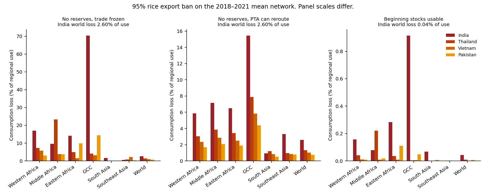

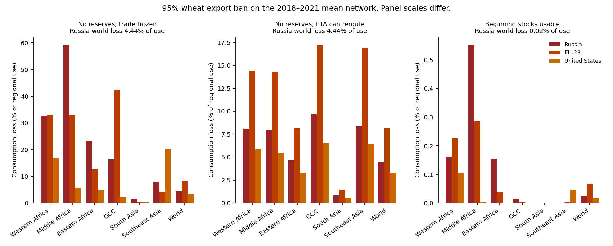

A 95% US maize ban is the reserve case that still leaves a visible world loss: 4.86% of world maize use with stocks unused, and 0.35% with beginning stocks fully usable.

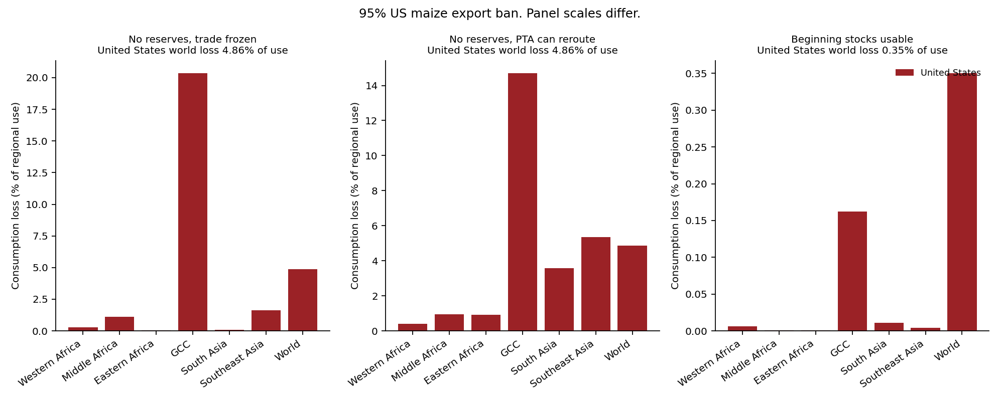

## Who is affected

Partners are ranked by tonnes, among countries with at least 0.1 Mt of baseline use. A ranking by percentage puts markets such as the Faroe Islands, whose entire rice use is about 155 tonnes, at the top of the list.

India rice ban, other exporters can reroute: Thailand 1.58 Mt (11% of use), Vietnam 1.13 Mt (5% of use), China 1.07 Mt (1% of use), Pakistan 0.89 Mt (22% of use), United States 0.74 Mt (16% of use).

India rice ban, trade frozen: Iran 1.07 Mt (29% of use), Saudi Arabia 1.02 Mt (74% of use), Benin 0.86 Mt (40% of use), Bangladesh 0.80 Mt (2% of use), Nepal 0.76 Mt (17% of use).

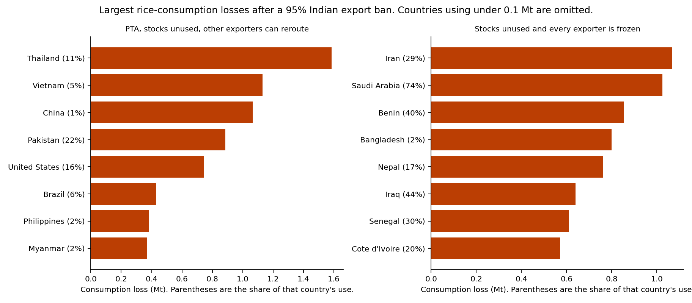

Russia wheat ban, other exporters can reroute: United States 2.72 Mt (10% of use), Canada 2.25 Mt (32% of use), France 1.87 Mt (11% of use), Ukraine 1.78 Mt (20% of use), Australia 1.34 Mt (12% of use).

Russia wheat ban, trade frozen: Egypt 6.32 Mt (30% of use), Iraq 2.18 Mt (30% of use), Bangladesh 1.77 Mt (24% of use), Yemen 1.67 Mt (41% of use), Nigeria 1.41 Mt (25% of use).

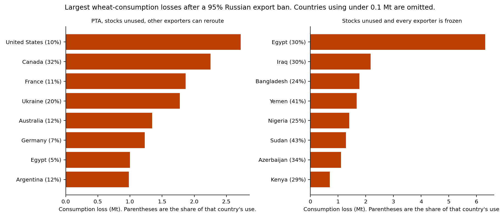

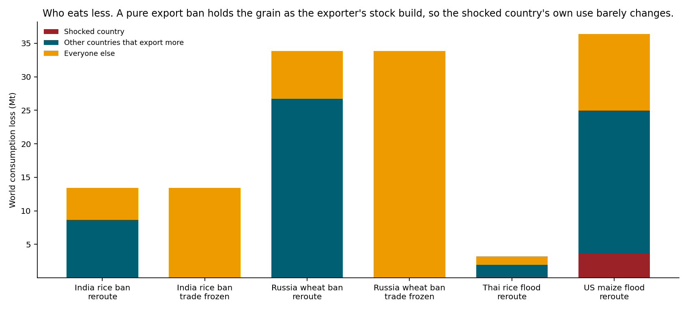

FSC takes only 1% of the remaining shortage out of domestic use on each iteration and pushes the rest into trade. Under the reroute setting, the Thai rice placeholder, a 15% production cut, removes about 3.2 Mt of world rice use and only a small share of that is Thai consumption. Published PTA with the freeze on does not do that for every exporter. The comparison table records the shocked country's share. These placeholder maps follow FSC. The stock-then-split option is a separate run on the observed draft table.

## Where the grain travels

Red arrows are the banned exporter's cuts of at least 50 kt. Teal arrows are increases of at least 50 kt on some other exporter's links. Orange circles are the larger consumption losses (0.2 Mt for rice, 0.8 Mt for wheat). The layout follows the route maps in Heslin et al., drawn on the 2018-2021 mean network.

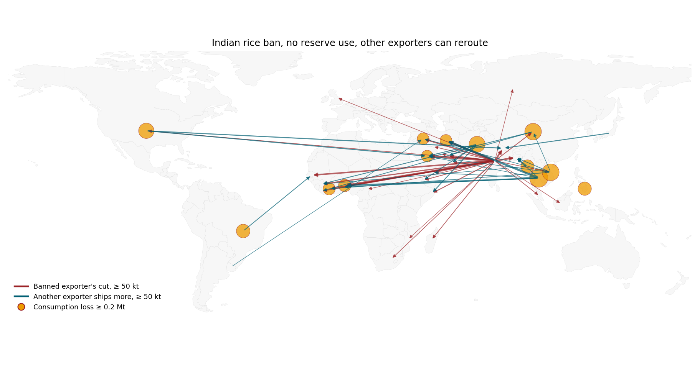

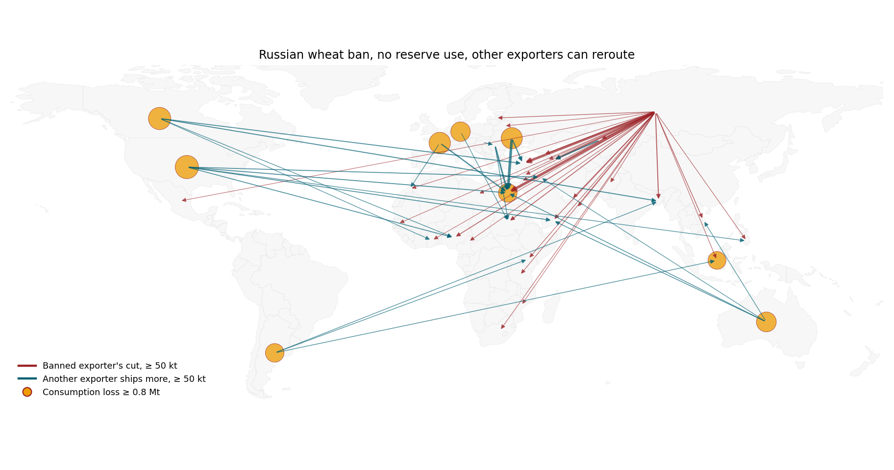

The choropleths use one color scale. The left map is PTA with rerouting and no reserve use. The right map is RTA with no reserve use, which leaves the loss on the importers. Countries above the cap are drawn at the cap.

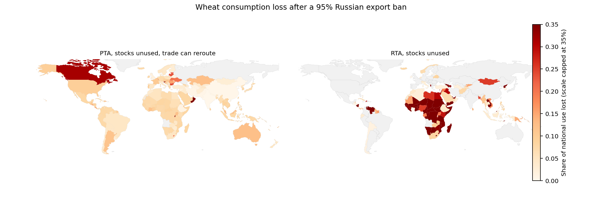

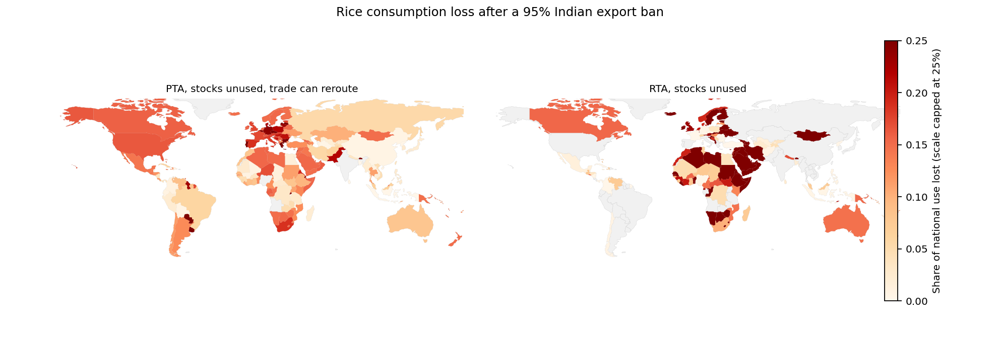

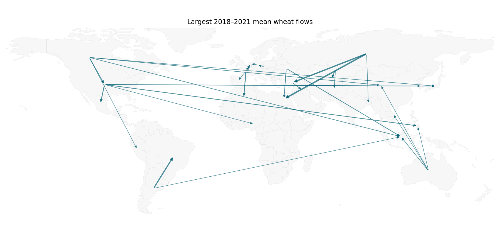

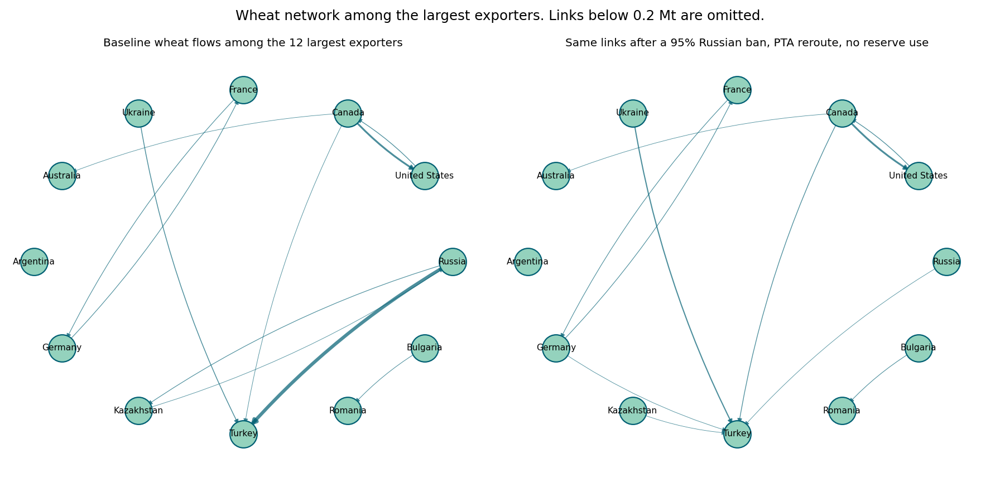

The wheat network has 2162 directed links of at least 1 kt and 227 Mt of trade. After the Russian ban with rerouting, 2134 links remain and trade is 205 Mt. Freezing every exporter, which is what alpha = 0 does in the published code, drops the wheat link count from 2162 to 1583.

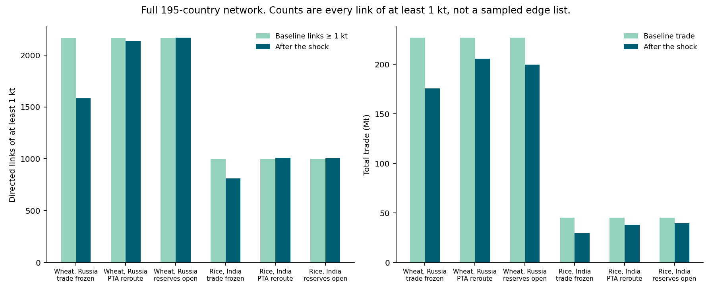

## Placeholder floods

The US maize placeholder is a 10% cut in US production, about 36.4 Mt of world consumption when stocks are unused. Adding a 95% export ban raises the world consumption loss to 92.1 Mt, because the ban holds a further block of exports as stocks. With beginning stocks usable, the production-only case is almost fully covered and the ban still leaves the same residue as the pure US maize ban. Replace `inputs/placeholder_flood_shocks.csv` before reading this panel as history. The US shock hits the whole United States node.

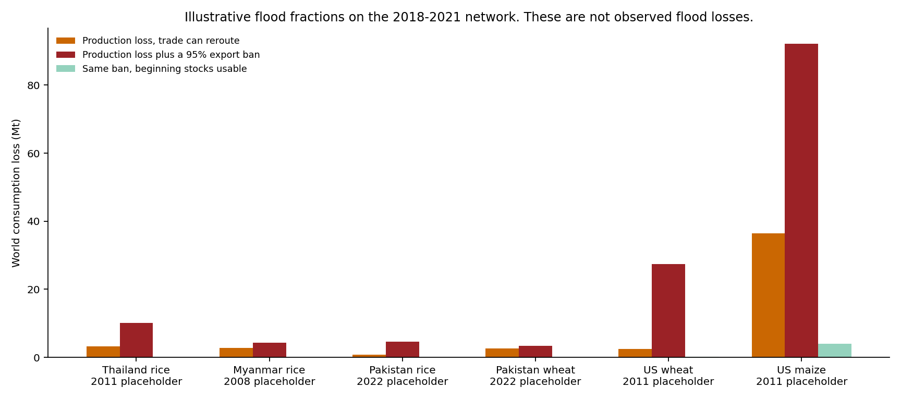

## Mass balance

World trade cancels. The change in world consumption equals the production change minus the net stock build, aside from any country whose domestic supply would have gone negative and was clipped to zero. A pure export ban has no production change. Its consumption loss is the stock build, the grain the exporter held back.

| Case | Rule | Alpha | Consumption lost (Mt) | Consumption gained (Mt) | Production change (Mt) | Stock change (Mt) | Gap (Mt) |
|---|---|---:|---:|---:|---:|---:|---:|
| maize_USA | frozen | 0 | 55.86 | 0.00 | 0.00 | 55.74 | -0.120 |
| maize_USA | frozen | 1 | 4.02 | 0.00 | 0.00 | 3.90 | -0.120 |
| maize_USA | reroute | 0 | 55.86 | 0.00 | 0.00 | 55.74 | -0.120 |
| maize_USA | rta | 0 | 55.86 | 0.00 | 0.00 | 55.74 | -0.120 |
| maize_USA | rta | 1 | 0.99 | 0.00 | 0.00 | 0.87 | -0.120 |
| rice_IND | frozen | 0 | 13.41 | 0.00 | 0.00 | 13.41 | -0.001 |
| rice_IND | frozen | 1 | 0.22 | 0.00 | 0.00 | 0.22 | -0.001 |
| rice_IND | reroute | 0 | 13.41 | 0.00 | 0.00 | 13.41 | -0.000 |
| rice_IND | rta | 0 | 13.41 | 0.00 | 0.00 | 13.41 | -0.001 |
| rice_IND | rta | 1 | 0.19 | 0.00 | 0.00 | 0.19 | -0.001 |
| us_midwest_2011_maize__production_only | frozen | 0 | 36.37 | 0.00 | -36.25 | 0.00 | -0.120 |
| us_midwest_2011_maize__production_only | frozen | 1 | 0.12 | 0.00 | -36.25 | -36.25 | -0.120 |
| us_midwest_2011_maize__production_only | reroute | 0 | 36.37 | 0.00 | -36.25 | 0.00 | -0.120 |
| us_midwest_2011_maize__production_plus_ban | frozen | 0 | 92.12 | 0.00 | -36.25 | 55.74 | -0.120 |
| us_midwest_2011_maize__production_plus_ban | frozen | 1 | 4.02 | 0.00 | -36.25 | -32.35 | -0.120 |
| us_midwest_2011_maize__production_plus_ban | reroute | 0 | 92.12 | 0.00 | -36.25 | 55.74 | -0.120 |
| wheat_RUS | frozen | 0 | 33.85 | 0.00 | 0.00 | 33.85 | 0.000 |
| wheat_RUS | frozen | 1 | 0.18 | 0.00 | 0.00 | 0.18 | 0.000 |
| wheat_RUS | reroute | 0 | 33.85 | 0.00 | 0.00 | 33.85 | 0.000 |
| wheat_RUS | rta | 0 | 33.85 | 0.00 | 0.00 | 33.85 | 0.000 |
| wheat_RUS | rta | 1 | 0.21 | 0.00 | 0.00 | 0.21 | -0.000 |

The largest identity gap is 0.37 Mt, on wheat_EU28 under the frozen rule at alpha 0. Every maize run shares a gap of about 0.12 Mt, including the production shock that reserves cover completely, so that residual is in the baseline maize balance. The wheat and rice headline runs sit within 1 kt.

## Red team

- Alpha 0 closes reserves and, in published PTA, also freezes every export row. The frozen panels are that published rule. The reroute panels turn the freeze off.
- World percentages under a ban are the size of the stock build. They stay the same when trade reroutes. The maps are what change.
- Rankings use tonnes and a 0.1 Mt use floor. Percentage losses in very small markets are real on this network and are a poor guide to where the grain went.
- FSC's 1% domestic-absorption step passes a production shock out through exports under the reroute setting. The placeholder flood maps follow FSC. Stock-then-split is a separate option and is the primary rule for the observed draft table.
- The rice price index is uncalibrated and is not a Pink Sheet result.
- EU-28 follows the existing FSC member list and includes the United Kingdom.
- Losses are shares of that commodity's use. They are not shares of calories or of a household food basket.
- A historical flood series needs an observed country-year loss table. The year on a shock row stays metadata while these benchmarks use the 2018-2021 mean.
