# Flood shocks, 2002 to 2024

This report measures physical availability of milled rice, wheat, and maize. A consumption decline here is a change in national commodity supply on the trade network. It is not household food consumption, not a calorie shortage, and not a measure of access or utilization.

The shock table is the draft dated 20 November 2026. `shock_total_t` is the loss applied in calendar year t. It already adds the same-year flood loss and the second-year loss from floods in the previous year. Rice is milled. Each crop-year is run on that year's production, net trade, and USDA beginning stocks. A blank beginning stock is zero. Imputed stocks are not used. Alpha is only 0 or 1. There is no price step and no export ban.

Stock-then-split is the primary rule. It draws usable stocks, then splits any remaining deficit of at least 1 tonne between exports and domestic use in proportion to the two, and passes the export cut along links that already exist. Modified PTA, with the empty-reserve freeze off, is the sensitivity. In that sensitivity the published update still takes only 1 percent of the remaining shortage out of domestic use, so the loss moves through trade. Published PTA, with the freeze on, is not the flood result.

Rows for 2015 to 2024 come from a 1/16 to 1/32 sample of the Sentinel-1 archive. Full-archive flooded area is larger, and those rows will be replaced. Rows for 2002 to 2014 will not. The dashed line on the annual figure is that break.

## Headline

With beginning stocks open, stocks take almost all of the harvest loss, and the consumption decline that remains stays in the flooded countries. With no stocks, rice and maize keep about 90 percent of the consumption decline at home. Wheat keeps 76 percent, and in 2010 and 2011 only about half. The sentence that flood losses mostly stay at home is a fair description of the stock case. It is the wrong lead for wheat when stocks cannot be drawn.

| Crop | Production loss (Mt) | No stocks, share in flooded countries | Stocks open, drawn from stocks | Stocks open, remaining consumption loss (Mt) | Of the stock draw, share in flooded countries | Modified PTA, no stocks, share in flooded countries |
|---|---:|---:|---:|---:|---:|---:|
| Milled rice | 30.67 | 90.1% | 96.5% | 1.09 | 99.9% | 44.4% |
| Wheat | 27.66 | 75.6% | 99.9% | 0.03 | 100.0% | 29.5% |
| Maize | 26.04 | 89.8% | 96.0% | 1.04 | 99.5% | 32.6% |

The three crops together lose 84.37 Mt over 2002 to 2024. 32.9% of that total sits in the provisional 2015 to 2024 rows. Same-year losses are 62.9% of the applied shock. The rest is the second-year term.

GFD years, 2002 to 2014, million tonnes: Milled rice 22.26, Wheat 16.20, Maize 18.14. Sentinel sample, 2015 to 2024: Milled rice 8.41, Wheat 11.46, Maize 7.90.

## Where the harvest was lost

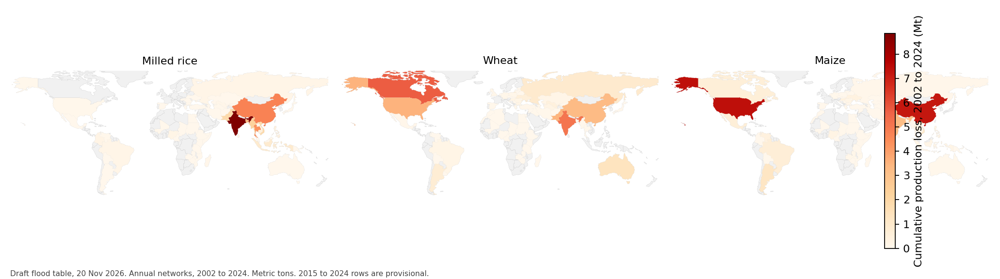

The largest cumulative losses are concentrated in a few producers. Milled rice: India 8.85 Mt; China 4.70 Mt; Thailand 4.31 Mt; Bangladesh 3.30 Mt; Myanmar 2.28 Mt. Wheat: Canada 5.67 Mt; India 5.08 Mt; United States 3.52 Mt; Pakistan 3.47 Mt; China 3.30 Mt. Maize: United States 7.39 Mt; China 7.20 Mt; India 3.20 Mt; Argentina 1.23 Mt; Vietnam 0.98 Mt.

Three crop-country-years were capped at production before this run: PNG maize 2003 (6,000 t), TKM maize 2016 (10,292 t), PNG rice_milled 2003 (536 t). The cap is in the table. The simulator also refuses a loss above baseline production.

## Stock-to-use

Stock-to-use here is beginning stocks divided by network domestic use. Network use is production plus imports minus exports in that year. It is not the USDA domestic-use series, and the two do not always agree. A blank beginning stock is a zero in this ratio, which treats a missing report as an empty reserve.

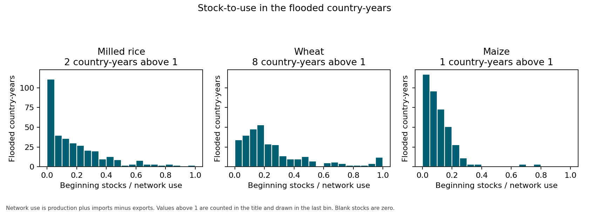

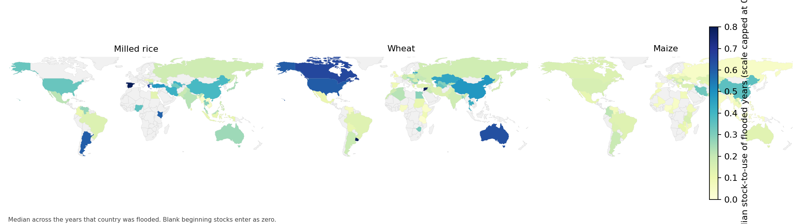

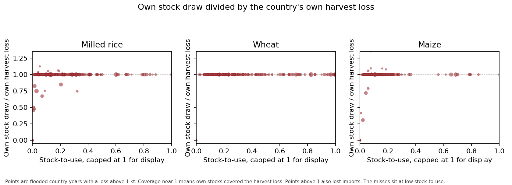

Harvest loss by the flooded country's stock-to-use, million tonnes. Country-years with no positive network use are in the lowest bin.

| Stock-to-use | Rice | Wheat | Maize |
|---|---:|---:|---:|
| Under 0.05 | 5.40 | 0.18 | 3.61 |
| 0.05 to 0.20 | 10.12 | 8.11 | 13.46 |
| 0.20 to 0.50 | 11.26 | 8.18 | 3.85 |
| Above 0.50 | 3.88 | 11.19 | 5.13 |

Of the harvest loss, 0.1% falls on country-years whose USDA beginning stock is missing (16 of 1066 shock rows). Those countries cannot draw a reserve in this run. That is a data choice, not a finding that the reserve was empty.

Almost all of the stock draw is inside the flooded countries: Milled rice 99.9%, Wheat 100.0%, Maize 99.5%. Partners do not replace these lost imports out of their own stocks in any material quantity. 45 flooded country-years draw more than their own harvest loss, by 34 kt in total. The largest is China milled rice in 2012, a harvest loss of 15 kt and a draw of 25 kt. Those countries were also importers, so the extra draw replaces a lost import. It is not a second copy of the harvest loss.

## Where consumption fell

Each panel has its own color scale. A shared scale would hide the rice map under the maize totals, and it would hide the split map under the wider modified-PTA declines.

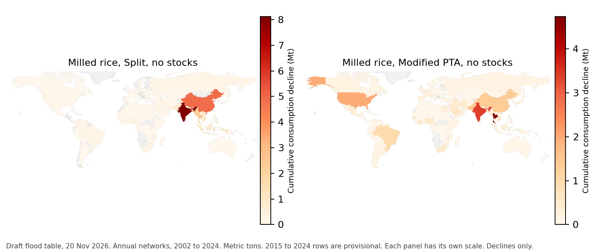

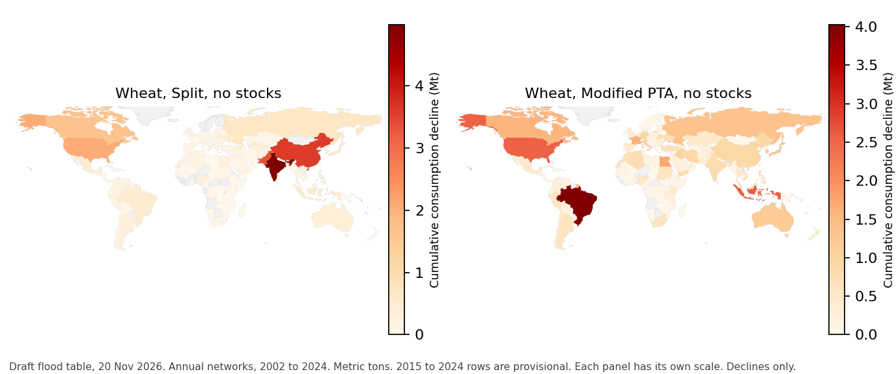

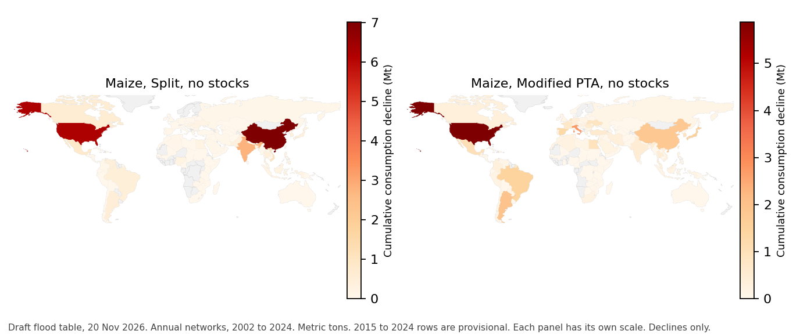

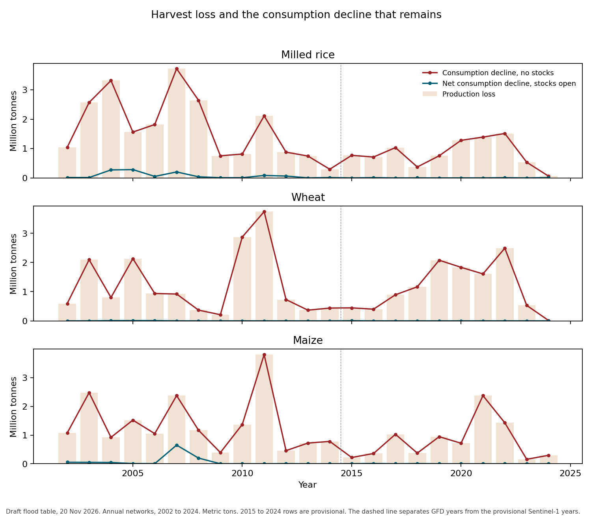

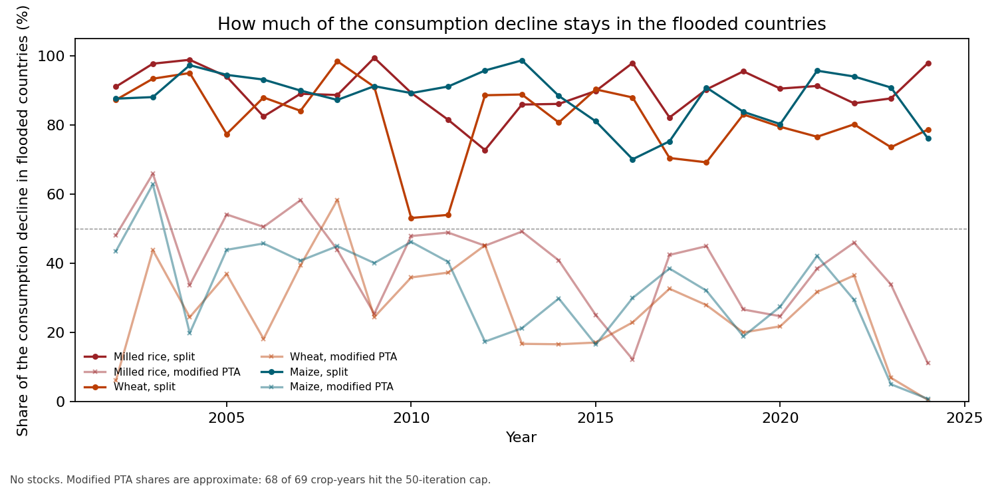

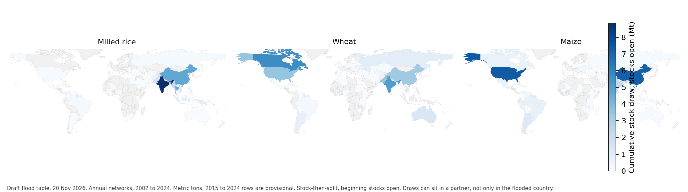

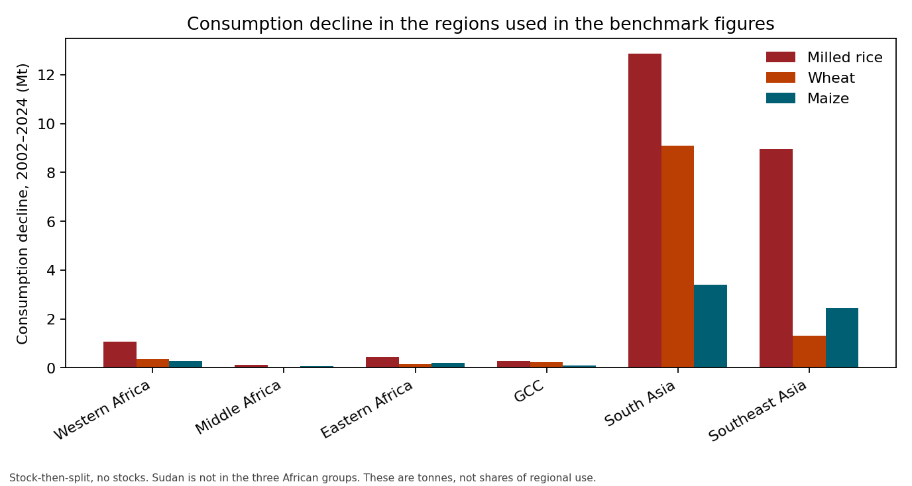

With no stocks, the years in which less than 60 percent of the consumption decline stays in the flooded countries are:

- Wheat 2010: 53.1% stays home, and 1.35 Mt falls elsewhere, out of a 2.87 Mt harvest loss.
- Wheat 2011: 54.0% stays home, and 1.72 Mt falls elsewhere, out of a 3.74 Mt harvest loss.

The largest partner consumption losses under stock-then-split with no stocks, among countries with at least 0.1 Mt of baseline use, are below. The percentage is that country's loss divided by its own baseline use. Losses are spread across many partners. None of these large-use partners loses a large share of its own use.

| Crop | Year | Country | Loss (Mt) | Share of that country's use |
|---|---:|---|---:|---:|
| Wheat | 2011 | Japan | 0.19 | 2.8% |
| Wheat | 2011 | Republic of Korea | 0.14 | 3.2% |
| Maize | 2011 | Japan | 0.13 | 0.9% |
| Wheat | 2010 | Japan | 0.11 | 1.9% |
| Wheat | 2010 | Italy | 0.10 | 0.7% |
| Wheat | 2011 | Indonesia | 0.10 | 1.8% |
| Wheat | 2011 | Nigeria | 0.10 | 2.4% |
| Wheat | 2011 | Italy | 0.10 | 0.7% |
| Maize | 2003 | Republic of Korea | 0.09 | 1.0% |
| Wheat | 2010 | Bangladesh | 0.09 | 2.1% |
| Wheat | 2010 | Republic of Korea | 0.08 | 1.9% |
| Wheat | 2011 | Venezuela | 0.08 | 5.2% |

Countries with under 0.1 Mt of baseline use can show a large percentage from a small tonnage. The highest such percentage in this run is 8.0%. Those percentages are not used to rank impact.

## Trade networks in the years that transmit

Arrows are reductions on links that already existed. The split does not open a new link and does not increase another exporter's shipments. Red arrows start in a flooded country. Teal arrows are a later country passing a lost import onward by cutting its own exports. Red circles are consumption losses in flooded countries. Orange circles are losses in partners.

### Milled rice 2007

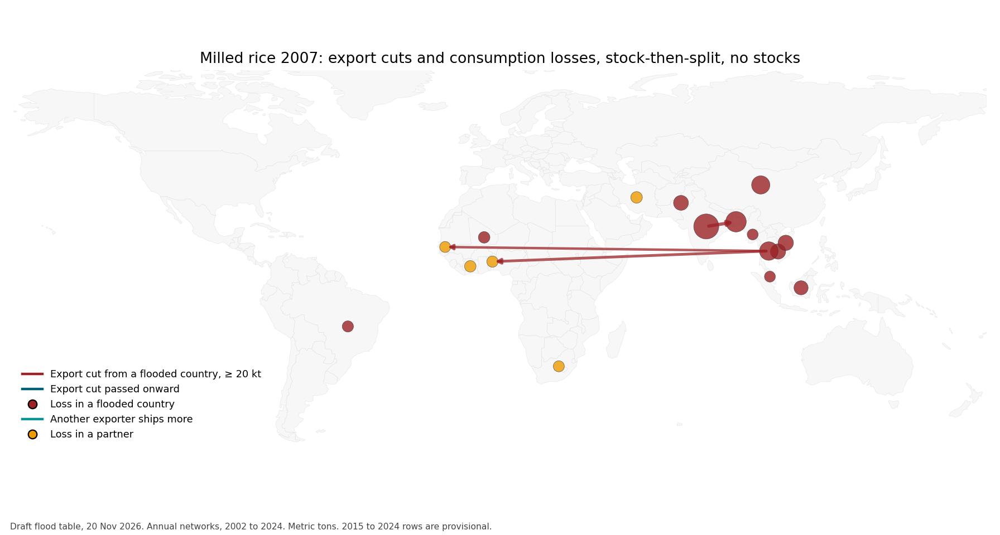

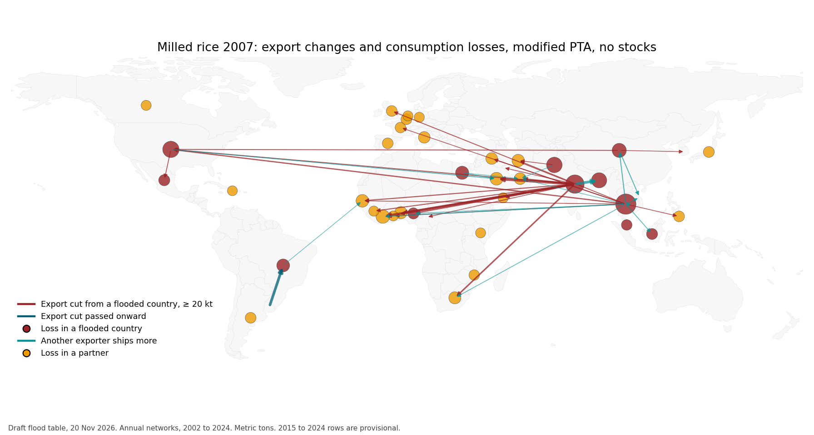

### Wheat 2011

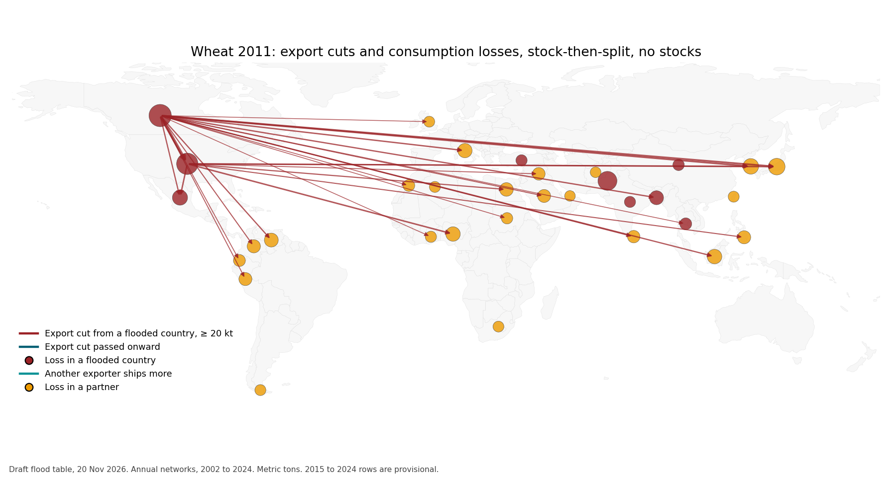

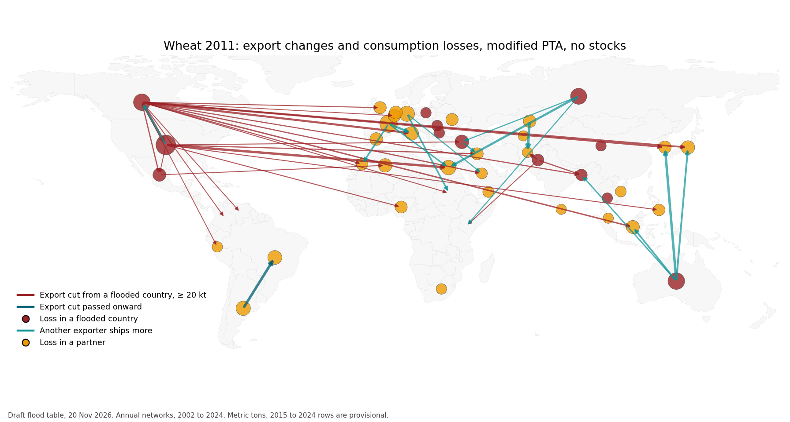

### Maize 2011

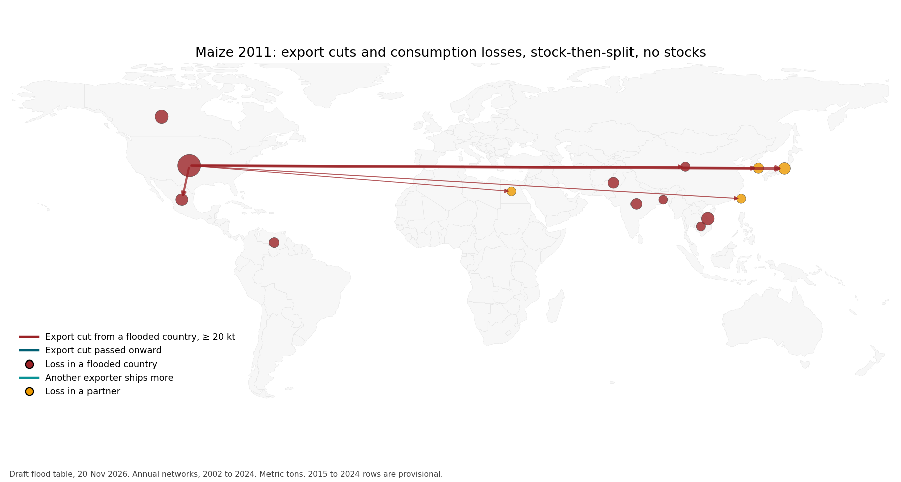

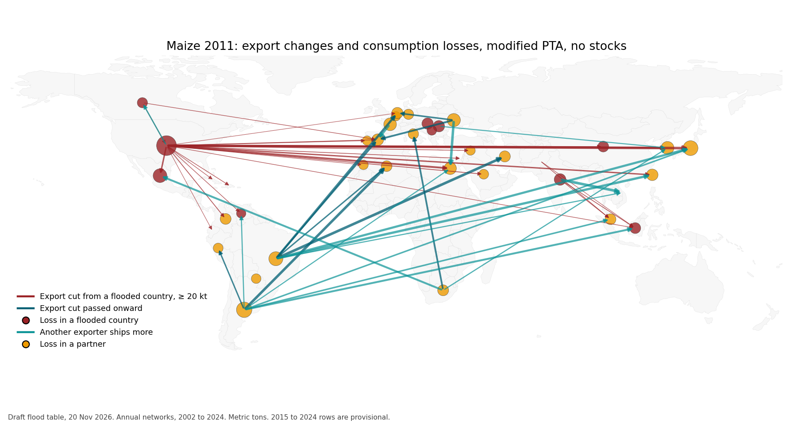

### Wheat 2010

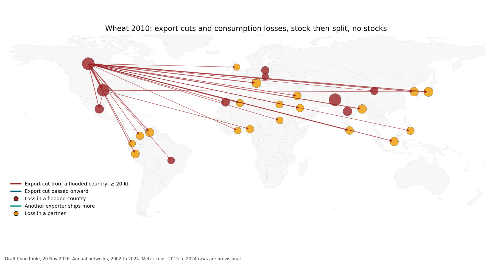

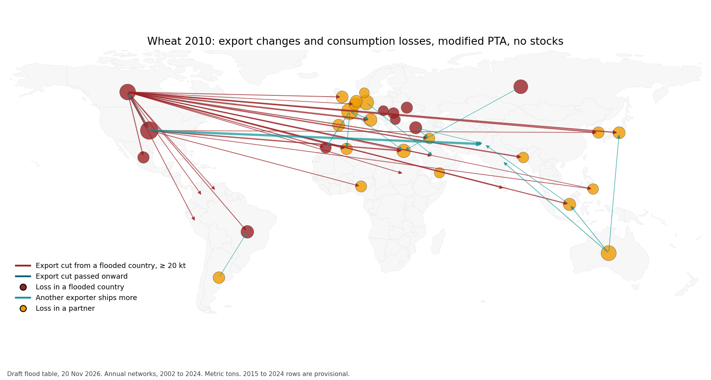

The wheat 2011 panel below keeps the twelve countries with the largest consumption losses and the export cuts among them.

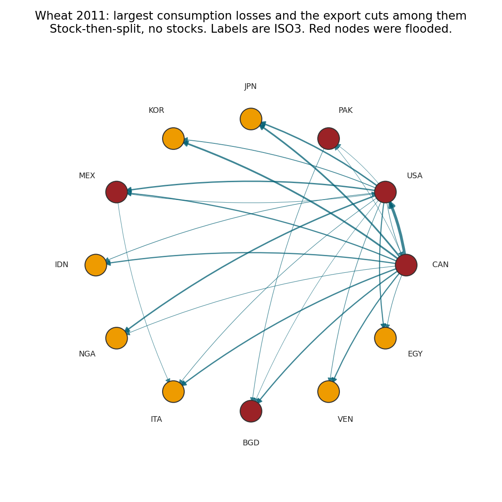

Modified PTA on the same years moves more of the loss out of the flooded countries, and other exporters can increase shipments on existing links. Those maps are the sensitivity, not a second estimate of the same behavior. Modified PTA reached the iteration cap in 68 of 69 crop-years with no stocks, so the partner ranking on those maps is approximate. The world consumption decline under the split, with no stocks, matches the harvest loss. Under modified PTA the sum of country declines is larger than the harvest loss because some countries gain while others lose more.

## Red team

The table has 1066 crop-country-year rows and 432 country-years. All of those ISO3 codes are in the 195-country network, and the table's production matches the annual files to within a tonne. `shock_total_t` matches the sum of the same-year and second-year terms.

Stock-then-split converged on all 138 runs. New bilateral links across every rule and alpha: 0. A country never drew more than the stocks it was allowed to draw. The largest quantity gap in a split run is 81 tonnes. With no stocks, the largest gap between the harvest loss and the net consumption decline is 81 tonnes.

Modified PTA is a different story on convergence. 68 of the 69 no-stock crop-years stopped at 50 iterations. Its largest mass gap is 16.3 kt, on wheat in 2002 at alpha 0. The split's largest gap is 81 tonnes. Modified PTA ends by setting every country's use to its supply when supply is positive, and to zero when supply is negative. That closing step is what separates its balance from the split. The split leaves a negative baseline use in place. Four flooded country-years have one: Hungary maize 2007 (-0.90 Mt); Myanmar maize 2015 (-0.21 Mt); Australia wheat 2012 (-0.65 Mt); Australia wheat 2023 (-1.09 Mt). Consumption losses in the tables are computed from use floored at zero, so a negative baseline does not become a consumption gain. Applying the published closer to the split would cut those exports and invent a transmission the flood did not cause.

The stock result is sensitive to the stock definition. This run uses unshifted USDA beginning stocks. A cascade that uses the previous market year's ending stocks will not match these draws country by country. Missing beginning stocks are zero here, and they carry 0.1% of the harvest loss. Filling them would raise the stock absorption and lower the remaining consumption loss.

Network stock-to-use and the USDA stock-to-use ratio move together, but they are not the same series. Correlation by crop, on flooded country-years where both are defined: Milled rice 0.86, Wheat 0.66, Maize 0.77. 45 flooded country-years differ by more than 0.20. 4 flooded country-years have no positive network use, so the ratio is undefined and those tonnes were placed in the lowest bin of the table.

The 2015 to 2024 maps and totals are a lower bound on flooded area. They should not be read as a completed history, and they should not be compared with the 2002 to 2014 maps as if the satellite method were the same. Within the GFD period the rules and the stock accounting are the ones that will stand.

What this run does not say: it does not say that a household lost the national tonnage, that a price rose, or that a nutrition outcome followed. Producer prices, food CPI, and the World Bank pink sheet remain the evidence on access. No model price was computed.

## Files

`Rscript main/run_flood_shocks.R` writes the summary, country, and edge tables. `python3 main/plot_flood_report.py` writes this report and the figures.

